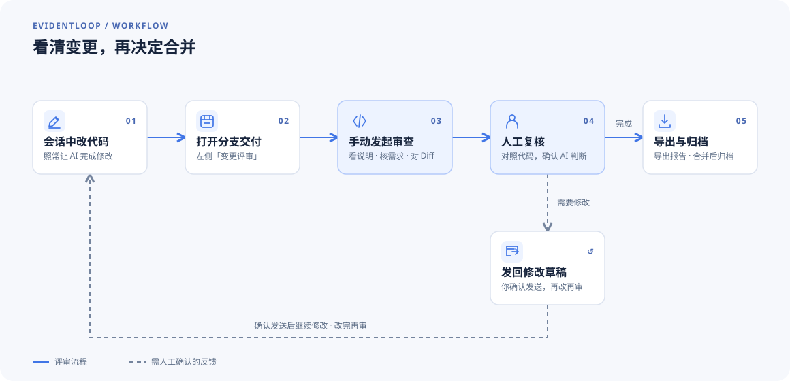
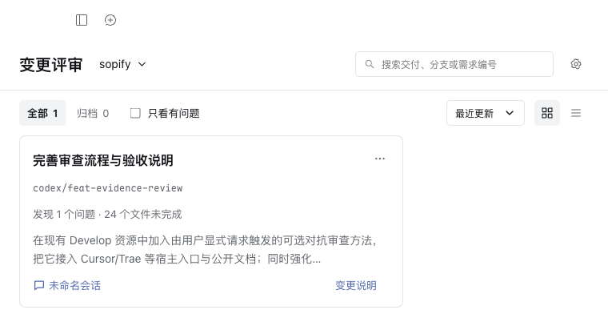

# 看清 AI 改了什么，再决定要不要合并

**EvidentLoop（AI 变更评审）** 是 [DeepSeek Harness（DSH）](https://github.com/deepseek-ai/deepseek-harness) 的 AI 代码变更评审插件：先看懂整批改动，再核对需求、复核问题，把修改意见发回会话。

<p align="center">
  <a href="https://github.com/evidentloop/dsh-evidentloop/releases"></a>
  <a href="https://github.com/deepseek-ai/deepseek-harness"></a>
  <a href="LICENSE"></a>
  <a href="package.json"></a>
  <a href="https://evidentloop.sanze.ai/demo.html"></a>
</p>

<p align="center">
  <picture>
    <source media="(prefers-color-scheme: dark)" srcset="docs/site/assets/diff-finding-dark.png">
    
  </picture>
</p>

<p align="center">单栏看代码，点问题看证据；AI 的判断由你复核。</p>

**[查看演示](https://evidentloop.sanze.ai/demo.html)** · **[安装指南](#安装指南)** · **[快速开始](#快速开始)** · **[功能图解](#核心功能图解)** · **[完整说明书](https://evidentloop.sanze.ai/guide.html)**

> [!NOTE]
> 当前版本为 **0.1.0-rc.1（Beta）**。审查需手动点击「审查全部」或对单个文件发起审查，自动审查将在后续版本支持。截图与录屏来自公开项目 Sopify 的真实历史审查记录快照，共 34 个变更文件：已实际审查 1 个，24 个待审，9 个按规则跳过。图中的批注与「标记非问题」为功能演示操作，不代表整批代码已全部审查完成。

## 为什么需要 EvidentLoop？

AI 一次改了十几个文件，只有 Diff 还不够：这批改动做了什么？有没有漏掉要求？审查意见能不能在代码里找到依据？

| 你遇到的问题 | EvidentLoop 帮你做什么 |
| --- | --- |
| 文件很多，看不清这次到底改了什么 | 按功能整理整批变更，说明改动原因、实现与行为影响 |
| 对话很多，担心需求被遗漏或改偏 | 核对会话需求和手动补充项，标出已对齐、未对齐 / 待确认、已调整与需求外改动 |
| AI 报了问题，却找不到对应代码 | 每个问题引用审查时保存的代码原文，引用的代码与实际改动不匹配时，该条问题会自动过滤、不予展示 |
| 复核后，还要手动整理反馈给 AI | 把问题和批注整理成会话草稿，由你确认后发送 |
| 改完就忘，评审过程难以回看 | 本机保留审查记录，并可导出 Markdown 和离线 HTML 报告 |

## 工作流与录屏

在会话里改代码，在评审台里看结果；需要修改时发回草稿，改完再审。



**44 秒看完整操作：交付列表 → 变更说明 → 单栏 Diff → 标记非问题 → 导出 → 发回会话。** 点击下方缩略图打开视频播放页。GitHub README 使用缩略图与链接；播放页支持内嵌播放。

<a href="https://evidentloop.sanze.ai/demo.html">
  <picture>
    <source media="(prefers-color-scheme: dark)" srcset="docs/site/assets/deliveries-dark.png">
    
  </picture>
</a>

[打开视频播放页](https://evidentloop.sanze.ai/demo.html) · [MP4 原文件](docs/site/assets/workflow.mp4) · [WebM 备用](docs/site/assets/workflow.webm)

## 安装指南

需要 **DeepSeek Harness 0.2.2 系列及兼容版本**、**Node.js ≥ 20**。当前插件清单声明的 DSH 兼容范围为 `^0.2.2-rc.2`，请以 [plugin/package.json](plugin/package.json) 和宿主兼容性检查为准。

### 1. 从 GitHub Release 下载

前往 [GitHub Releases](https://github.com/evidentloop/dsh-evidentloop/releases)，在 **0.1.0-rc.1** 的 Assets 中下载 `dsh-evidentloop-0.1.0-rc.1.tgz`。当前为 Beta，Release 及附件尚待发布；附件出现前可按文末的 [开发与贡献](#开发与贡献) 步骤生成同名离线包，或先打开 [在线演示](https://evidentloop.sanze.ai/demo.html)。

### 2. 在 DSH 安装离线包

已有 `.tgz` 离线安装包时，可从 DSH 侧栏进入 **「插件 → 添加插件」**，输入该离线包在 **DSH 所在机器**上的绝对路径，按提示安装并启用；或使用 DSH CLI：

```sh
dsh plugin add /absolute/path/dsh-evidentloop-0.1.0-rc.1.tgz
```

若 DSH 提示需要重启，重启后打开左侧「变更评审」。安装方式参见 [DSH 官方插件管理说明](https://github.com/deepseek-ai/deepseek-harness/blob/master/packages/client/ui-plugin-manager/README.zh.md)。

### 3. 通过自定义市场索引发现

DSH 的「发现」来自实验性的「自定义插件索引」，不内置统一商店。打开 **「插件 → 实验性插件 → 自定义插件索引」**，再到 **「发现 → 添加索引源」**，输入：

```text
https://raw.githubusercontent.com/evidentloop/dsh-evidentloop/main/docs/market/index.json
```

本仓提供 [Beta 索引清单](docs/market/index.json)，中文标题为「AI 变更评审」，英文标题为「EvidentLoop AI Code Review」。搜索「AI 变更评审」、`EvidentLoop` 或 `dsh-evidentloop`，核对来源与版本后安装并启用。索引使用固定提交的 Git 来源、插件目录 `plugin/`；不依赖 npm 发包，也不把 Release 压缩包写成不受支持的索引来源。当前未宣称进入官方市场，索引安装仍需在对应 DSH 版本上确认。详见 [DSH 官方插件索引指南](https://github.com/deepseek-ai/deepseek-harness/blob/master/docs/user/guide/plugin-market.zh.md)。

**Beta 试用提示：**真实模型审查需要单独启用并设置调用额度；安装插件本身不会发起模型请求。试用配置与当前限制见 [插件说明](plugin/README.md#隔离模型预算门禁)。

## 快速开始

完成安装与 Beta 审查配置后，用 3 步跑通第一次评审：

1. **改代码**：照常在 DSH 开发会话中让 AI 完成功能或修复。
2. **发起审查**：打开左侧「变更评审」，进入当前分支对应的评审交付页面，点击「审查全部」；也可以在文件列表中仅对单个关键文件发起审查。
3. **复核后发回草稿**：先看变更说明与需求核对，再点问题卡片对照 Diff；可对误报问题点击「标记非问题」，或添加人工批注。点击「发回会话」后，系统会将问题与批注生成修改草稿填入会话输入框，由你确认后再发送给 AI。

改完再次审查，未变的文件沿用上次结论。待审、跳过或失败的文件会保留状态，方便继续处理。

## 核心功能图解

### 1. 整批改动说明：先看懂做了什么

把分散在文件里的改动按功能整理，说明为什么改、怎么改、行为有什么变化。系统将「代码事实」与「模型推断」分别标注，方便你判断哪些内容需要进一步核实。概览中还会展示审查覆盖进度，尚未审查的文件也会清晰列出，便于后续跟进。

<picture>
  <source media="(prefers-color-scheme: dark)" srcset="docs/site/assets/overview-features-dark.png">
  
</picture>

### 2. 需求对齐：逐条核对有没有漏

会话里提过的需求和手动补充项一起核对，显示「已对齐」「未对齐 / 待确认」「已调整」及需求外改动。后续已取消或修改的要求归入「已调整」，方便你结合需求原文复核。

<picture>
  <source media="(prefers-color-scheme: dark)" srcset="docs/site/assets/overview-requirements-dark.png">
  
</picture>

### 3. 代码比对：从问题回到原文

单栏 Diff 展示增删变化，点击问题卡片可准确定位到代码行。每条问题均附带代码原文证据；若引用的代码与实际改动不匹配，该条问题会自动过滤、不予展示。**引用存在仍不等于判断正确**，你可以结合代码实际确认问题性质、潜在影响与修改建议。

<picture>
  <source media="(prefers-color-scheme: dark)" srcset="docs/site/assets/diff-changes-dark.png">
  
</picture>

### 4. 人工批注与标记：留下你的判断

可在代码行或问题卡片上添加人工批注；对不认同的审查意见，可以点击「标记非问题」排除，后续也可随时恢复。批注会随修改意见一并发回会话，让 AI 明确了解哪里需要改、为什么改。

<picture>
  <source media="(prefers-color-scheme: dark)" srcset="docs/site/assets/annotation-dark.png">
  
</picture>

### 5. 安全回填草稿：确认后再发送

将确认的问题、人工批注与未对齐需求一键整理到开发会话的输入框中。发送前可随时预览、补充或调整；**插件仅生成草稿，始终由你确认后主动发送**。

<picture>
  <source media="(prefers-color-scheme: dark)" srcset="docs/site/assets/draft-dark.png">
  
</picture>

### 6. 审查留档与导出：以后还能找回来

每次审查均会保存当时的代码快照与审查结论，支持随时回看历史只读记录；代码合并到目标分支后，对应的评审交付记录将自动移入「已归档」。支持导出用于合并请求（PR/MR）的 Markdown 变更日志，亦可生成单文件离线 HTML 报告（可自选是否嵌入完整 Diff）。

<picture>
  <source media="(prefers-color-scheme: dark)" srcset="docs/site/assets/export-dark.png">
  
</picture>

## 隐私与运行机制

- **代码只读**：读取本地 Git 工作树，不修改源码、暂存区或提交，也不替你合并分支。
- **记录保存在本机**：审查记录、人工批注与问题处置状态留在本地。
- **复用宿主模型**：直接调用你在 DSH 中已配置的模型执行审查，相关代码与需求均按 DSH 既有模型通道处理。插件不接入额外遥测、外部收集或上报服务；模型服务的数据处理方式取决于你的 DSH 配置。
- **导出前遮盖疑似密钥**：报告仍可能含代码片段和需求原文，分享前请检查内容。

当前按工作树与目标分支的差异审查，不按单个提交（commit）审查；暂不支持 Git 的 `split index` 特性，浅克隆（shallow clone）仓库需先补全历史。更多操作与限制见 [在线说明书](https://evidentloop.sanze.ai/guide.html) 或仓内 [docs/guide.md](docs/guide.md)。

## 开发与贡献

欢迎通过 [Issues](https://github.com/evidentloop/dsh-evidentloop/issues) 反馈问题，附上版本、操作步骤与可分享的复现信息。

- [plugin/](plugin/README.md)：React 评审台与 DSH 宿主适配。
- [core/](core/README.md)：纯 Node 核心库，负责快照、校验与导出。
- [skills/](skills/evidentloop-review/SKILL.md)：证据与需求对齐审查方法。
- [prototype/](prototype/README.md)：独立的离线交互原型，包含明确标注的合成数据。

### 本地构建、验证与打包

运行环境需 Node.js ≥ 20。`npm ci` 按锁文件安装 TypeScript、esbuild、React/ReactDOM 和 tsx 等开发工具；UI 测试还需已有 Playwright 及系统 Chrome。构建脚本不会自动下载安装依赖，可通过环境变量 `ESBUILD_PACKAGE`、`REACT_PACKAGE`、`PLAYWRIGHT_PACKAGE` 分别指定对应的 `package.json` 路径。

```sh
# 安装固定版本的开发工具并检查类型
npm ci
npm run typecheck

# 构建插件与说明书
node plugin/scripts/build.mjs
node docs/build.mjs

# 核心与插件测试
node core/tests/all.mjs /tmp/evidentloop-core-tests
node --import tsx plugin/tests/run.mjs /tmp/evidentloop-plugin-tests
node --import tsx plugin/tests/browser-headless.mjs /tmp/evidentloop-ui-tests

# 生成本地离线安装包（.tgz）；输出路径需在仓库外且文件尚不存在
node plugin/scripts/package.mjs /tmp/dsh-evidentloop-0.1.0-rc.1.tgz
```

测试使用模拟适配器（合成测试数据），不调用真实模型。打包命令仅生成本地离线安装包，不会对外发布，也不会静默启用真实模型审查。

## 许可与来源

[MIT](LICENSE)，Copyright (c) 2026 sanze.li。界面基于作者个人原型，插件客户端独立实现。

Diff 渲染使用 diff2html，文件树图标来自 Material Icon Theme；第三方代码与图形保留各自许可，详见 [THIRD_PARTY_NOTICES.md](THIRD_PARTY_NOTICES.md)。
