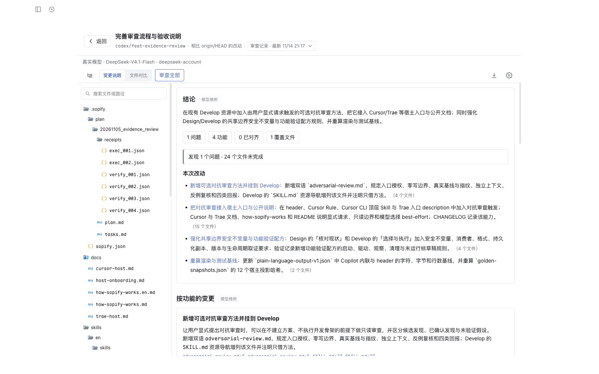
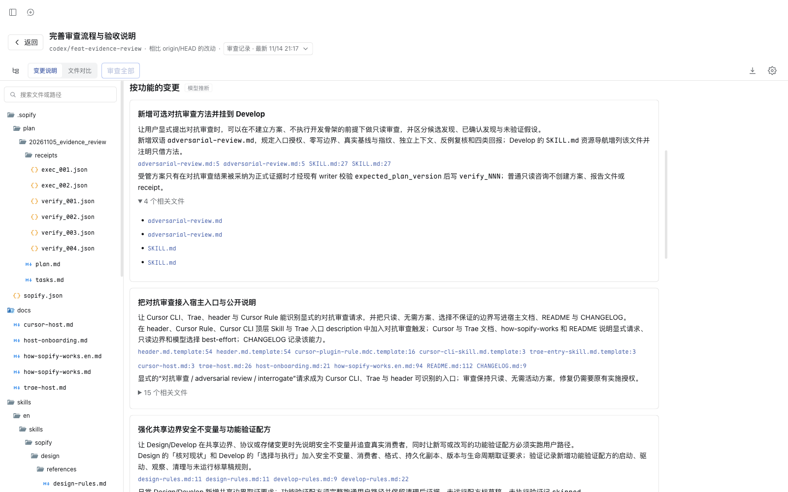
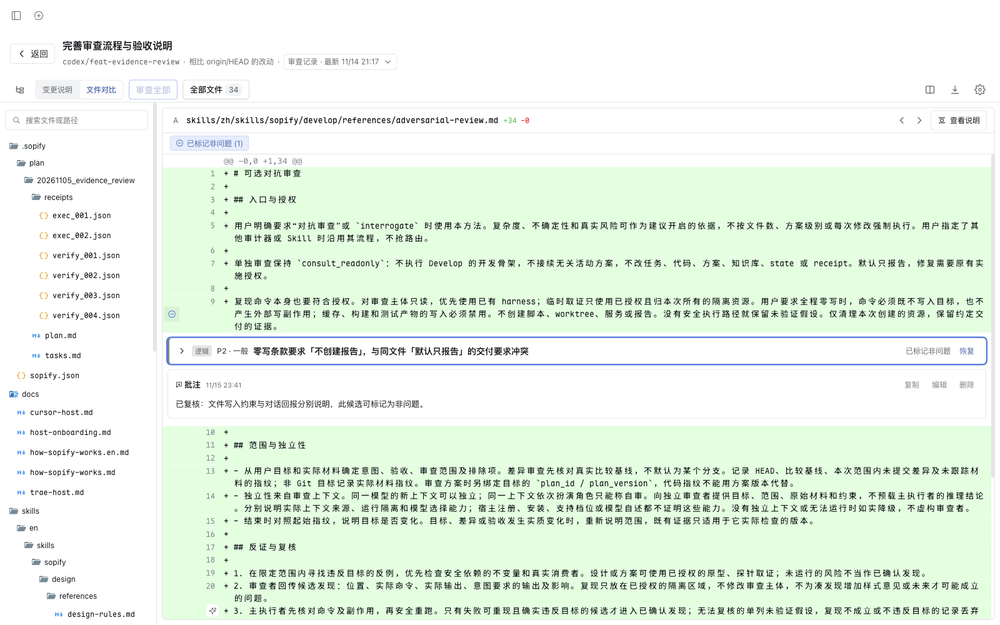
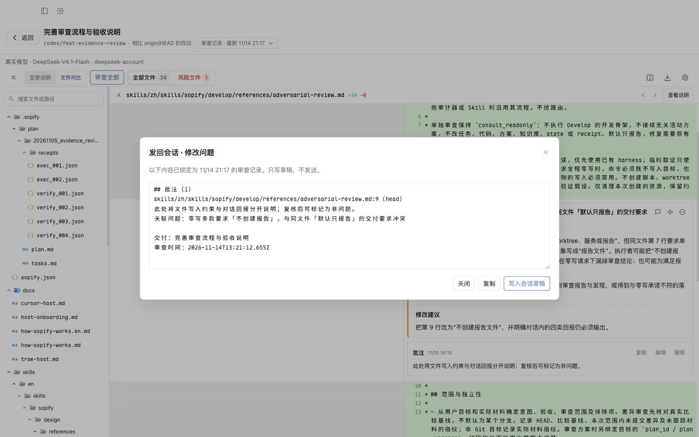

# 看清 AI 改了什么，再决定要不要合并

<p align="center">
  <a href="https://github.com/evidentloop/dsh-evidentloop/releases/tag/v0.1.0-rc.1"></a>
  <a href="https://github.com/deepseek-ai/deepseek-harness"></a>
  <a href="LICENSE"></a>
  <a href="https://evidentloop.sanze.dev/demo.html"></a>
</p>

**EvidentLoop（AI 变更评审）** 是 DeepSeek Harness 的代码评审插件。它把一批代码改动整理成可验收的交付：解释改了什么，核对需求，给出有代码依据的问题，再把修改意见发回开发会话。

<picture>
  <source media="(prefers-color-scheme: dark)" srcset="docs/site/assets/diff-finding-dark.png">
  
</picture>

[交互流程图](https://evidentloop.sanze.dev/flow.html) · [观看 44 秒操作演示](https://evidentloop.sanze.dev/demo.html) · [下载 MP4](docs/site/assets/workflow.mp4)

## 为什么需要 EvidentLoop

AI 一次改完十几个文件，打开 Diff，满屏都是红绿行。逐行看得懂，却不容易回答：这批改动到底做了什么？有没有漏掉会话里提过的要求？审查意见指出的问题，代码里真的有依据吗？

EvidentLoop 把这些问题放进同一个评审台。先按功能理解改动，再对照需求和代码复核；需要修改的地方留下批注，发回会话后继续迭代。合并前，你能看到审过哪些文件、还有哪些没审完。

插件只读取本地改动，不修改代码、暂存区或提交。当前版本需手动发起审查，自动触发尚未接入。

## 安装

运行环境需要 DeepSeek Harness 兼容版本 `^0.2.2-rc.2`（若从源码构建开发，需 Node.js ≥ 20）。

1. **选择安装来源**：通过 [npm Beta 包](https://www.npmjs.com/package/dsh-evidentloop)安装，或从 [GitHub Release](https://github.com/evidentloop/dsh-evidentloop/releases/tag/v0.1.0-rc.1) 下载 `dsh-evidentloop-0.1.0-rc.1.tgz`，保存到运行 DSH 的机器。
2. **安装并启用**：打开 DSH 的 **插件 → 添加插件**，输入 `dsh-evidentloop@beta` 或离线包的绝对路径。也可以用命令行安装到当前使用的 profile：

   ```sh
   # 从 npm 安装 Beta 版本
   dsh plugin --profile desktop add dsh-evidentloop@beta --registry=https://registry.npmjs.org
   # 或安装已下载的离线包
   dsh plugin --profile desktop add /absolute/path/dsh-evidentloop-0.1.0-rc.1.tgz
   ```

   将 `desktop` 替换为实际使用的 profile。安装后启用插件；如宿主提示需要重启，重启后打开侧栏「变更评审」。
3. **配置审查调用**：安装本身不会发起模型请求。Beta 期间真实审查需要单独配置调用额度，按[插件配置说明](plugin/README.md#隔离模型预算门禁)完成设置后，再发起审查。

也可通过自定义索引安装：在 **插件 → 实验性插件 → 自定义插件索引** 启用该功能，再到 **发现 → 添加索引源**，填入[本仓库的插件索引](https://raw.githubusercontent.com/evidentloop/dsh-evidentloop/main/docs/market/index.json)。搜索「AI 变更评审」或 `EvidentLoop`，核对版本和来源后安装。该索引为项目自建源，尚未收录进 DSH 官方插件市场；市场安装路径暂未完成端到端验证。

## 快速开始

1. **在会话里改代码**。照常让 AI 完成功能或修复，再打开侧栏「变更评审」，进入当前分支对应的交付。无需先提交；新仓库还没有首次提交时，也能审查本地文件，空仓库会给出提示。
2. **手动发起审查**。点击「审查全部」，或只审查一个文件。先看「变更说明」里的目标、功能和需求，再看审查覆盖；待审、跳过或失败都不等于已经通过。
3. **复核并发回修改**。在「文件对比」中检查问题的代码依据，添加批注或标记非问题。从「导出与发回」预览修改意见，再写入会话草稿，由你确认发送。

改完再次审查，未变的文件沿用上次结论；每次审查都保留记录，可以回看或导出。

<picture>
  <source media="(max-width: 600px)" srcset="docs/site/flow-narrow.svg">
  
</picture>

## 功能图解

以下画面来自公开项目 Sopify 的真实审查记录，界面随 DSH 切换浅深主题。这份记录只审了 1 个文件，24 个待审、9 个跳过；人工批注和「标记非问题」展示复核操作，不表示整批代码已通过。

### 先看总览，知道这批改动审到了哪里

「变更说明」汇总交付目标、本次改动和审查结论。功能数量、问题数量与覆盖状态放在一起，方便先掌握全貌，再决定从哪里看起。

<picture>
  <source media="(prefers-color-scheme: dark)" srcset="docs/site/assets/overview-summary-dark.png">
  
</picture>

### 按功能读懂改动，顺着引用找到代码

一个功能可能跨多个文件。「按功能的变更」把为什么改、怎么改和行为影响放在一起，并列出相关文件与代码引用。说明会区分「代码事实」和「模型推断」，便于你对照判断。

<picture>
  <source media="(prefers-color-scheme: dark)" srcset="docs/site/assets/overview-features-dark.png">
  
</picture>

### 核对需求，保留需要确认的地方

插件收集会话里的需求，也支持手动补充依据；审查后列出已对齐、待确认、已调整和需求外改动。「已调整」表示被后来的要求修改或取消。这份演示记录没有附带需求原文，界面保留空状态；下图展示补充依据的入口，添加后需重新审查。

<picture>
  <source media="(prefers-color-scheme: dark)" srcset="docs/site/assets/overview-requirements-dark.png">
  
</picture>

### 对照 Diff，逐条复核问题

在「文件对比」中浏览文件树，用左右箭头切换文件，在单栏 Diff 中查看增删。审查发现的问题会定位到代码行并引用原文；与代码无法对应的不予展示，结论是否成立仍需你结合上下文复核。

<picture>
  <source media="(prefers-color-scheme: dark)" srcset="docs/site/assets/diff-changes-dark.png">
  
</picture>

### 留下批注，也能标记非问题

在代码行或问题上写下复核依据，避免修改意见只停留在口头。不认同的结论可以「标记非问题」，之后仍能恢复；人工判断与模型意见一并保留。

<picture>
  <source media="(prefers-color-scheme: dark)" srcset="docs/site/assets/annotation-dark.png">
  
</picture>

### 发回会话前，先预览修改意见

把待处理问题、批注和未对齐的需求整理成修改意见，预览后写入开发会话的输入框。插件不会自动发送，你可以确认或编辑后再交给 AI。

<picture>
  <source media="(prefers-color-scheme: dark)" srcset="docs/site/assets/draft-dark.png">
  
</picture>

### 导出报告，方便交付与回看

导出 Markdown 变更日志，用于合并请求或交付文档；也可导出单文件离线 HTML，并按需附带完整 Diff。报告含代码片段和需求原文，分享前请检查内容。

<picture>
  <source media="(prefers-color-scheme: dark)" srcset="docs/site/assets/export-dark.png">
  
</picture>

## 文档

- [离线交互原型](prototype/index.html)：下载仓库后在本机打开，操作方式见[原型说明](prototype/README.md)。
- [完整使用说明](https://evidentloop.sanze.dev/guide.html)：交付管理、审查状态、设置与常见问题；[仓库内版本](docs/guide.md)。
- [DSH 官方插件管理说明](https://github.com/deepseek-ai/deepseek-harness/blob/master/packages/client/ui-plugin-manager/README.zh.md)与[自定义索引指南](https://github.com/deepseek-ai/deepseek-harness/blob/master/docs/user/guide/plugin-market.zh.md)：宿主的安装入口与索引配置。

## 开发

在仓库根目录运行；UI 测试使用已有 Playwright 与系统 Chrome。

```sh
npm ci
npm run build
node --import tsx plugin/tests/run.mjs /tmp/evidentloop-plugin-tests
node --import tsx plugin/tests/browser-headless.mjs /tmp/evidentloop-ui-tests
node core/tests/all.mjs /tmp/evidentloop-core-tests
node plugin/scripts/package.mjs /tmp/dsh-evidentloop-0.1.0-rc.1.tgz
```

指定的输出目录运行前须不存在，安装包路径须在仓库外。测试使用合成数据，不调用真实模型。客户端与宿主位于 [plugin/](plugin/README.md)，快照、校验和导出位于 [core/](core/README.md)，审查方法位于 [skills/](skills/evidentloop-review/SKILL.md)。

## 许可

[MIT](LICENSE)，Copyright (c) 2026 sanze.li。第三方代码与图形保留原许可，见 [THIRD_PARTY_NOTICES.md](THIRD_PARTY_NOTICES.md)。
