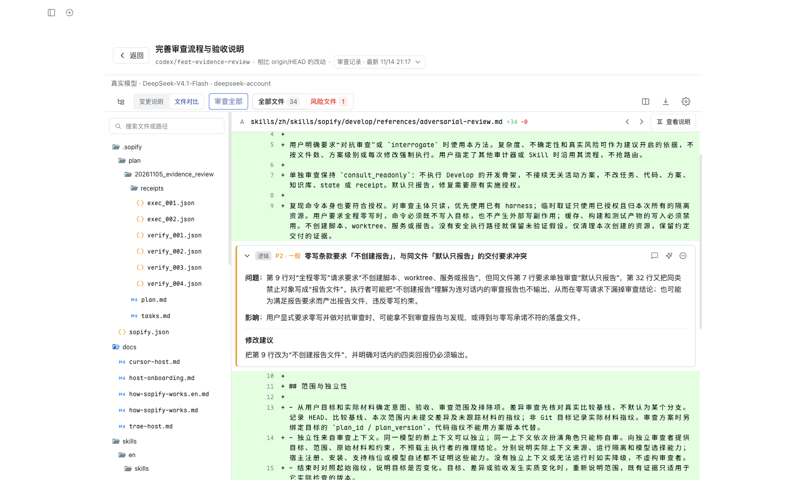
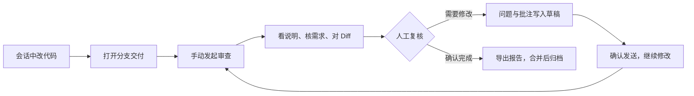
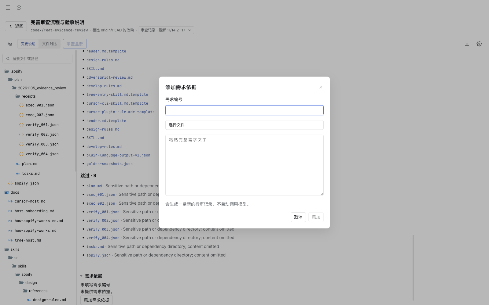
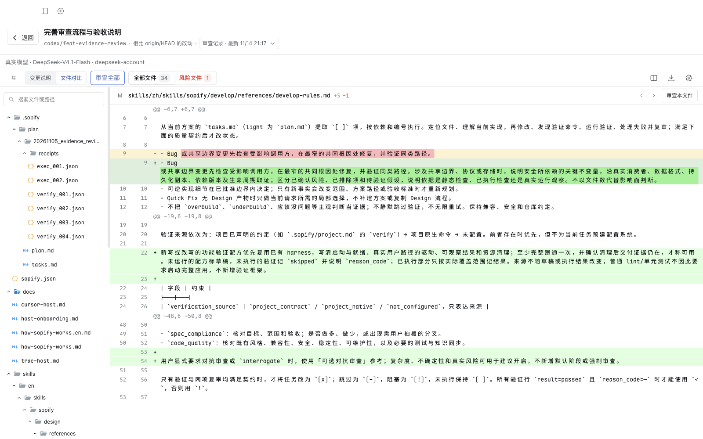
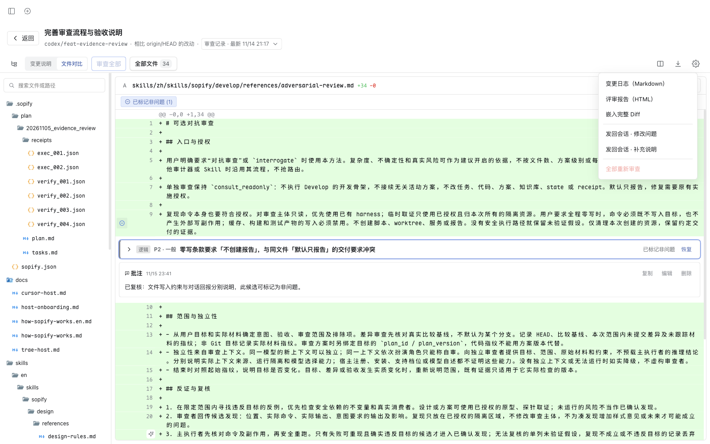

# 看清 AI 改了什么，再决定要不要合并

**EvidentLoop（阅变）** 是 [DeepSeek Harness（DSH）](https://github.com/deepseek-ai/deepseek-harness) 的 AI 代码变更评审插件：先看懂整批改动，再核对需求、复核问题，把修改意见发回会话。

<p align="center">
  <a href="https://github.com/evidentloop/dsh-evidentloop/releases"></a>
  <a href="https://github.com/deepseek-ai/deepseek-harness"></a>
  <a href="LICENSE"></a>
  <a href="package.json"></a>
  <a href="https://evidentloop.sanze.ai/demo.html"></a>
</p>

<p align="center">
  <picture>
    <source media="(prefers-color-scheme: dark)" srcset="docs/site/assets/diff-finding-dark.png">
    
  </picture>
</p>

<p align="center">双栏看代码，点问题看证据；AI 的判断由你复核。</p>

**[查看演示](https://evidentloop.sanze.ai/demo.html)** · **[安装指南](#安装指南)** · **[快速开始](#快速开始)** · **[功能图解](#核心功能图解)** · **[完整说明书](https://evidentloop.sanze.ai/guide.html)**

> [!NOTE]
> 当前版本为 **0.1.0-rc.1（beta）**。审查由你点击「审查全部」或单文件审查发起，自动触发留待后续版本。截图与录屏来自公开项目 Sopify 的已冻结真实模型记录：仅覆盖 1 个可审文件，其余 24 个仍显示待审；批注与标记是演示操作，不代表整批代码已审完。

## 为什么需要 EvidentLoop？

AI 一次改了十几个文件，只有 Diff 还不够：这批改动做了什么？有没有漏掉要求？审查意见能不能在代码里找到依据？

| 你遇到的问题 | EvidentLoop 帮你做什么 |
| --- | --- |
| 文件很多，看不清这次到底改了什么 | 按功能整理整批变更，说明改动原因、实现与行为影响 |
| 对话很多，担心需求被遗漏或改偏 | 核对会话需求和手动补充项，标出已对齐、待确认、已调整与需求外改动 |
| AI 报了问题，却找不到对应代码 | 每个问题引用审查时保存的代码原文，引用核对不上的候选不展示 |
| 复核后，还要手动整理反馈给 AI | 把问题和批注整理成会话草稿，由你确认后发送 |
| 改完就忘，评审过程难以回看 | 本机保留审查记录，并可导出 Markdown 和离线 HTML 报告 |

## 工作流与录屏

在会话里改代码，在评审台里看结果；需要修改时发回草稿，改完再审。



**43 秒看完整操作：交付列表 → 变更说明 → Diff → 标记非问题 → 导出 → 发回会话。** 点击下方缩略图观看 MP4。

<a href="docs/site/assets/workflow.mp4">
  <picture>
    <source media="(prefers-color-scheme: dark)" srcset="docs/site/assets/deliveries-dark.png">
    
  </picture>
</a>

https://github.com/evidentloop/dsh-evidentloop/raw/refs/heads/main/docs/site/assets/workflow.mp4

[打开视频播放页](https://evidentloop.sanze.ai/demo.html) · [MP4 原文件](docs/site/assets/workflow.mp4) · [WebM 备用](docs/site/assets/workflow.webm)

## 安装指南

需要 **DeepSeek Harness 0.2.2 系列及兼容版本**、**Node.js ≥ 20**。当前插件清单声明的 DSH 兼容范围为 `^0.2.2-rc.2`，请以 [plugin/package.json](plugin/package.json) 和宿主兼容性检查为准。

### 通过 DSH 插件市场安装

DSH 的插件市场来自你添加的索引源，并非内置统一商店。**当前 Beta 尚未提供市场索引或 Release 安装附件**；想先看看效果，可以直接打开[在线演示](https://evidentloop.sanze.ai/demo.html)。

当你使用的索引源收录此插件后，在 DSH 侧栏打开 **「插件 → 发现」**，搜索 `EvidentLoop` 或 `dsh-evidentloop`，核对来源与版本后安装并启用。如何启用「发现」及添加索引源，见 [DSH 官方插件索引指南](https://github.com/deepseek-ai/deepseek-harness/blob/master/docs/user/guide/plugin-market.zh.md)。

### 加载本地离线包（Beta 试用）

已有 `.tgz` 候选包时，可从 DSH 侧栏进入 **「插件 → 添加插件」**，填入包在 **DSH 所在机器**上的绝对路径，按提示安装并启用；或使用 DSH CLI：

```sh
dsh plugin add /absolute/path/dsh-evidentloop-0.1.0-rc.1.tgz
```

本地包可按文末的[开发与贡献](#开发与贡献)步骤生成；后续公开包以 [GitHub Releases](https://github.com/evidentloop/dsh-evidentloop/releases) 为准。宿主若提示需要重启，重启后再打开左侧「变更评审」。安装方式参见 [DSH 官方插件管理说明](https://github.com/deepseek-ai/deepseek-harness/blob/master/packages/client/ui-plugin-manager/README.zh.md)。

**Beta 试用提示：**真实模型审查需要单独启用并设置调用额度；安装插件本身不会发起模型请求。试用配置与当前限制见 [插件说明](plugin/README.md#隔离模型预算门禁)。

## 快速开始

完成安装与 Beta 审查配置后，用 3 步跑通第一次评审：

1. **改代码**：照常在 DSH 开发会话中让 AI 完成功能或修复。
2. **点「审查全部」**：打开左侧「变更评审」，进入当前分支的交付；也可以只审一个关键文件。
3. **复核后发回草稿**：先看变更说明与需求核对，再点问题卡片对照 Diff；可标记非问题、添加批注。点击「发回会话」后，问题与批注写入输入框，检查后由你发送给 AI。

改完再次审查，未变的文件沿用上次结论。待审、跳过或失败的文件会保留状态，方便继续处理。

## 核心功能图解

### 1. 整批改动说明：先看懂做了什么

把分散在文件里的改动按功能整理，说明为什么改、怎么改、行为有什么变化。「代码事实」与「模型推断」分别标注，方便你判断哪些需要进一步核实。概览还会显示审查覆盖，待审文件继续可见。

<picture>
  <source media="(prefers-color-scheme: dark)" srcset="docs/site/assets/overview-features-dark.png">
  
</picture>

### 2. 需求对齐：逐条核对有没有漏

会话里提过的需求和手动补充项一起核对，显示「已对齐」「未对齐 / 待确认」「已调整」及需求外改动。后续已取消或修改的要求归入「已调整」，方便你结合需求原文复核。

<picture>
  <source media="(prefers-color-scheme: dark)" srcset="docs/site/assets/overview-requirements-dark.png">
  
</picture>

### 3. 代码比对：从问题回到原文

双栏 Diff 展示增删变化，点击问题可定位到代码行。每条问题带原文证据；引用核对不上的候选不展示。**引用存在仍不等于判断正确**，你可以结合代码确认问题、影响与建议。

<picture>
  <source media="(prefers-color-scheme: dark)" srcset="docs/site/assets/diff-changes-dark.png">
  
</picture>

### 4. 人工批注与标记：留下你的判断

在代码行或问题上补充批注；不认同的候选可以「标记非问题」，也可以恢复。批注可随反馈一起发回，让 AI 知道你要改哪里、为什么改。

<picture>
  <source media="(prefers-color-scheme: dark)" srcset="docs/site/assets/annotation-dark.png">
  
</picture>

### 5. 安全回填草稿：确认后再发送

把问题、批注与未对齐需求整理到开发会话的输入框。发送前可以预览、补充或修改；**插件只写草稿，由你确认发送**。

<picture>
  <source media="(prefers-color-scheme: dark)" srcset="docs/site/assets/draft-dark.png">
  
</picture>

### 6. 审查留档与导出：以后还能找回来

每次审查保存当时的代码与结论，可回看历史只读记录；合并到目标分支后，交付自动归档。导出 Markdown 变更日志用于合并请求，或生成单文件离线 HTML 报告，并选择嵌入完整 Diff。

<picture>
  <source media="(prefers-color-scheme: dark)" srcset="docs/site/assets/export-dark.png">
  
</picture>

## 隐私与运行机制

- **代码只读**：读取本地 Git 工作树，不修改源码、暂存区或提交，也不替你合并分支。
- **记录保存在本机**：审查记录、人工批注与问题处置状态留在本地。
- **复用宿主模型**：通过你在 DSH 中配置的模型审查，相关代码与需求会按宿主既有模型通道处理。插件不接入额外遥测、外部收集或上报服务；模型服务的数据处理方式取决于你的 DSH 配置。
- **导出前遮盖疑似密钥**：报告仍可能含代码片段和需求原文，分享前请检查内容。

当前按工作树与目标分支的差异审查，不按单个 commit 审查；暂不支持 split index，浅克隆需先补全历史。更多操作与限制见 [在线说明书](https://evidentloop.sanze.ai/guide.html) 或仓内 [docs/guide.md](docs/guide.md)。

## 开发与贡献

欢迎通过 [Issues](https://github.com/evidentloop/dsh-evidentloop/issues) 反馈问题，附上版本、操作步骤与可分享的复现信息。

- [plugin/](plugin/README.md)：React 评审台与 DSH 宿主适配。
- [core/](core/README.md)：纯 Node 核心库，负责快照、校验与导出。
- [skills/](skills/evidentloop-review/SKILL.md)：证据与需求对齐审查方法。
- [prototype/](prototype/README.md)：独立的离线交互原型，包含明确标注的合成数据。

### 本地构建、验证与打包

使用 Node.js ≥ 20。构建需要已有的 esbuild；插件测试还需要已有的 React、ReactDOM、Playwright 与系统 Chrome。脚本不自动安装依赖，可通过 `ESBUILD_PACKAGE`、`REACT_PACKAGE`、`PLAYWRIGHT_PACKAGE` 指定对应的 package.json。

```sh
# 构建插件与说明书
node plugin/scripts/build.mjs
node docs/build.mjs

# 核心与插件测试
node core/tests/all.mjs /tmp/evidentloop-core-tests
node plugin/tests/run.mjs /tmp/evidentloop-plugin-tests
node plugin/tests/browser-headless.mjs /tmp/evidentloop-ui-tests

# 生成本地候选包；输出路径需在仓库外且文件尚不存在
node plugin/scripts/package.mjs /tmp/dsh-evidentloop-0.1.0-rc.1.tgz
```

测试使用合成适配器，不调用真实模型。打包命令只生成本地候选包，不发布或启用真实模型审查。

## 许可与来源

[MIT](LICENSE)，Copyright (c) 2026 sanze.li。界面基于作者个人原型，插件客户端独立实现。

Diff 渲染使用 diff2html，文件树图标来自 Material Icon Theme；第三方代码与图形保留各自许可，详见 [THIRD_PARTY_NOTICES.md](THIRD_PARTY_NOTICES.md)。
