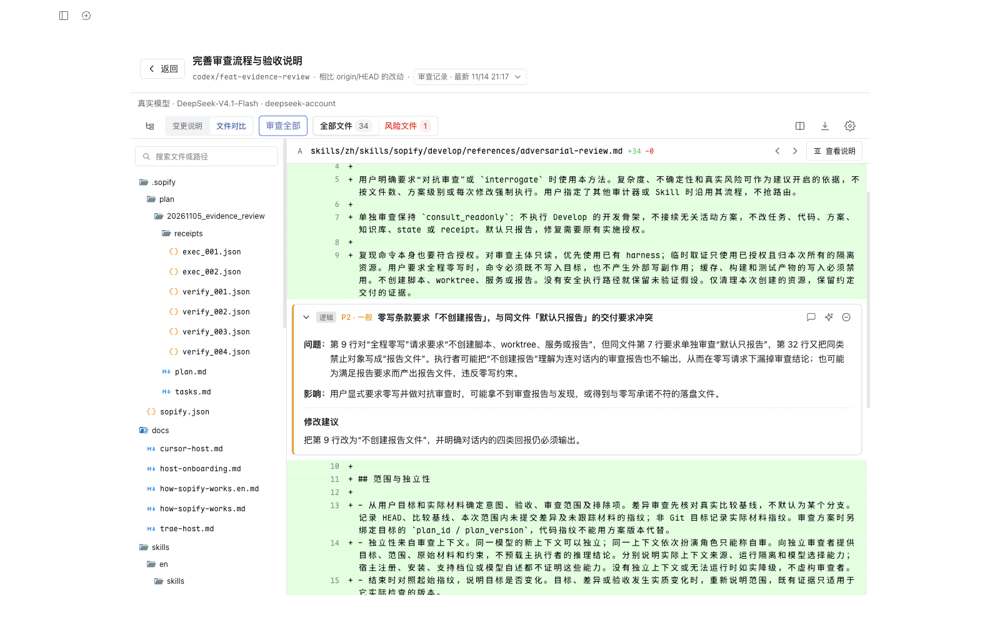

# EvidentLoop（AI 变更评审）

<p align="center">
  <a href="https://github.com/evidentloop/dsh-evidentloop/releases/tag/v0.1.0-rc.2"></a>
  <a href="https://github.com/deepseek-ai/deepseek-harness"></a>
  <a href="https://github.com/evidentloop/dsh-evidentloop/blob/main/LICENSE"></a>
  <a href="https://evidentloop.sanze.dev/demo.html"></a>
</p>

把 AI 改动整理成可复核的交付：先看变更说明、核对需求，再逐条检查代码依据；需要修改时，把意见发回开发会话草稿，由你确认发送。当前处于 Beta 阶段，审查需手动发起。



[交互流程图](https://evidentloop.sanze.dev/flow.html) · [44 秒操作实录](https://evidentloop.sanze.dev/demo.html) · [完整使用说明](https://evidentloop.sanze.dev/guide.html)

## 安装

需要 DeepSeek Harness 兼容版本 `^0.2.2-rc.2`。在 **插件 → 添加插件** 中输入 `@evidentloop/dsh-evidentloop@beta`，或安装到当前使用的 profile：

```sh
dsh plugin --profile desktop add @evidentloop/dsh-evidentloop@beta --registry=https://registry.npmjs.org
```

将 `desktop` 替换为实际使用的 profile。安装后启用插件，按宿主提示重启，再打开侧栏「变更评审」。

也支持以下来源：

- **离线包**：从 [GitHub Release](https://github.com/evidentloop/dsh-evidentloop/releases/tag/v0.1.0-rc.2) 下载 `dsh-evidentloop-0.1.0-rc.2.tgz`，保存到运行 DSH 的机器，在 **插件 → 添加插件** 中输入包的绝对路径。
- **自定义索引**：先启用 **插件 → 实验性插件 → 自定义插件索引**，再在 **发现 → 添加索引源** 填入[项目索引](https://raw.githubusercontent.com/evidentloop/dsh-evidentloop/main/docs/market/index.json)，搜索「AI 变更评审」并核对来源后安装。该索引为项目自建源，尚未收录进 DSH 官方插件市场；市场安装路径暂未完成端到端验证。

## 配置审查

先在 DSH 中配置可用模型。审查使用发起操作的开发会话所选模型；无关联会话时，使用 DSH 当前默认模型。未配置可用模型时，插件会提示你先完成配置。

进入当前分支对应的交付，点击「审查全部」或审查单个文件，才会发起模型请求。安装、查看本地改动和保存设置不会调用模型；自动审查默认关闭，当前版本尚未接入自动触发。

检查问题的代码依据，留下批注，再从「导出与发回」预览修改意见。改完再次审查，未变的文件沿用上次结论。

## 数据与安全

- 插件不修改代码、暂存区或提交；新仓库还没有首次提交时，也能审查本地文件。
- 发起模型审查会把必要的代码和需求内容交给 DSH 所选模型，请先确认模型服务适合处理这些内容。
- 审查记录保存在本机。导出报告可能含代码与需求原文，分享前请检查；发回会话只写入草稿，不会自动发送。
- 模型意见需要人工复核；待审、跳过或失败都不等于已经通过。

## 开发

从源码构建需 Node.js ≥ 20，在仓库根目录运行。UI 测试使用已有 Playwright 和系统 Chrome。

```sh
npm ci
npm run build
npm test -- /tmp/evidentloop-core-tests
npm run test:ui -- /tmp/evidentloop-ui-tests
node plugin/scripts/package.mjs /tmp/dsh-evidentloop-0.1.0-rc.2.tgz
```

测试输出目录与安装包路径须在仓库外，运行前应不存在。测试使用合成数据，不调用真实模型；打包命令只生成本地文件。

模块分工：`client/` 提供评审界面，`host/` 连接 DSH 与本地审查服务，`core/` 负责快照、证据校验和导出，`skills/` 定义审查方法。客户端使用宿主提供的 React，主题跟随 DSH。

## 许可

[MIT](https://github.com/evidentloop/dsh-evidentloop/blob/main/LICENSE)，Copyright (c) 2026 sanze.li。第三方许可见 [THIRD_PARTY_NOTICES.md](https://github.com/evidentloop/dsh-evidentloop/blob/main/plugin/THIRD_PARTY_NOTICES.md)。
